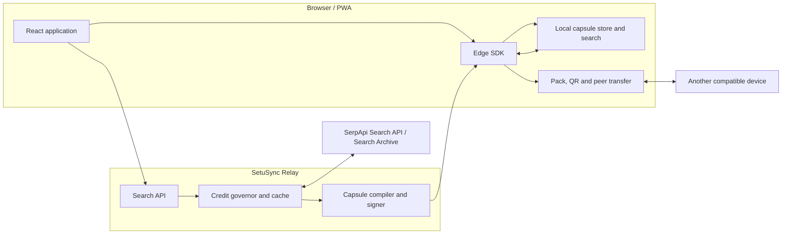

# SetuSync

**Make SerpApi-powered knowledge portable, reusable, and available beyond the live search session.**

SetuSync is an offline-first knowledge layer built around SerpApi. It takes the value created by a live search and helps it travel further: a result can become a signed knowledge capsule, be stored and searched on a device, reused without repeating the same acquisition, and shared with another person through a file, QR code, or nearby peer-to-peer transfer.

The idea is bigger than adding a search box to an app. **SetuSync explores a new way for SerpApi-powered information to reach people and places where a reliable, continuous internet connection cannot be assumed.** SerpApi remains the online discovery engine; SetuSync adds a portable, verifiable reuse-and-sharing layer around the information it helps retrieve.

---

## The idea: extend what search can do

A live search is valuable, but its usefulness can end when the connection drops, the same question is asked again, or someone nearby needs the same information on a different device.
SetuSync changes the lifecycle of a search result:
1. **Discover with SerpApi.** The Relay requests live search results through SerpApi when acquisition is allowed and needed.
2. **Package the result.** SetuSync compiles the result into a structured knowledge capsule and signs it.
3. **Keep it close.** The device stores capsules locally so previously acquired information can be searched without a live request.
4. **Share it onward.** A user can export a capsule pack, display QR frames, or exchange data with a compatible nearby device.
5. **Reuse responsibly.** Freshness information and signature verification help users distinguish a stored, verifiable capsule from a new live search.

That gives SerpApi-powered discovery a longer useful life than a single online request. Instead of treating every result as something to fetch and discard, SetuSync treats it as knowledge that can be retained, verified, carried, and reused.

## Why this matters for SerpApi

**SerpApi is the engine at the centre of SetuSync—not a badge added to an unrelated product.** SetuSync's acquisition path depends on SerpApi to retrieve search results. The rest of the system is designed around what can happen to those results after retrieval.

The project explores a complementary product direction for search infrastructure:

- **Reach beyond always-online users.** Previously acquired results can remain useful in low-connectivity environments.
- **Make results reusable across people and devices.** Signed capsule packs, QR transfer, and nearby exchange create ways for SerpApi-powered information to move beyond the original requester.
- **Reduce avoidable repeat acquisition.** Local storage and the Relay's cache can reuse results when the implementation considers requests equivalent and policy permits reuse.
- **Support community knowledge workflows.** A person or organization can prepare useful search material while online and make it available locally or share it with others.
- **Make trust part of the transfer.** Signatures let a recipient verify that capsule content has not changed since it was signed by a trusted key.
- **Create a platform layer for future experiences.** A portable capsule format and edge SDK can serve as building blocks for applications that need searchable information under intermittent connectivity.

This is an exploration of how SerpApi-powered search can become more portable and resilient. It does **not** claim that SerpApi itself is offline or that SetuSync can retrieve new live search results without connectivity. SerpApi provides the live acquisition; SetuSync helps preserve and distribute previously acquired results.

## Who could benefit

The same pattern can support different settings where information needs to remain useful between connections:

- **Community and public-interest organizations** preparing locally relevant information for outreach.
- **Field teams and mobile workers** who may need to consult previously retrieved material in areas with unreliable connectivity.
- **Learning and research groups** sharing a prepared collection of search results with peers.
- **Travel, events, and local support workflows** where users may want access to previously acquired information after going offline.
- **Developers building resilient search experiences** who want local storage, signed content, and transfer primitives around online discovery.

These are potential use cases enabled by the design, not claims of existing customer adoption or a measured commercial outcome.

## How SerpApi powers the system

SerpApi is the upstream search acquisition service used by the SetuSync Relay.

1. The web application sends a search request to the SetuSync Relay.
2. The Relay applies request handling, cache, and credit-governor rules.
3. When a cache miss is eligible for live acquisition, the Relay submits the request to SerpApi.
4. The Relay retrieves asynchronous results through the Search Archive flow where applicable.
5. The result is compiled into a knowledge capsule and signed with an Ed25519 key.
6. The client verifies the capsule and stores it locally for later search, reuse, synchronization, and sharing.

The integration is implemented in `apps/relay`. The configured engine and request parameters depend on the request and application configuration; the demo is configured for Google Search. Check the source and configuration before deploying with a different engine.

### Why SerpApi is essential here

Without SerpApi, SetuSync would not have its configured live search acquisition path. The capsule, cache, offline store, and transfer mechanisms are designed to extend the usefulness of the search results obtained through that path. SerpApi supplies the discovery capability; SetuSync experiments with making the resulting knowledge more durable, portable, and useful under connectivity constraints.

## Architecture



## Core capabilities

| Capability | What it enables |
|---|---|
| SerpApi-powered live acquisition | Retrieve search results through the Relay when online and permitted by policy |
| Local capsule store and offline search | Reuse previously acquired results without a live request |
| Durable outbox and sync engine | Queue supported requests and retry after connectivity returns |
| Signed Capsule Packs (`.setupack`) | Export and import capsule bundles with integrity verification |
| QR transfer | Move small bundles between devices using QR frames |
| Nearby peer transfer | Exchange data between compatible devices on a suitable local network |
| Delta sharing | Send differences when the receiver has the exact required base version |
| Freshness metadata and policies | Make the age and expected volatility of stored information visible |
| Query normalization and cache | Reuse results for requests treated as equivalent by the implementation |
| On-device semantic search | Find related stored content after the model has been downloaded |
| Network simulation and impact views | Explore constrained-connectivity scenarios and local reuse metrics |
| Installable PWA | Reopen the application after installation or a prior visit, subject to browser support |
| Credit governor | Configure monthly and per-install acquisition limits and a global kill switch |

## Trust and security model

SetuSync is designed so that content can travel over channels that are not themselves trusted.

- Capsules are signed by the Relay using Ed25519 over the canonical capsule content.
- Clients verify signatures against configured or pinned public keys before treating imported content as verified.
- Unknown signing keys should not be silently trusted; review the key fingerprint and trust flow before accepting a new key.
- A signing key ID must not be rebound to a different public key.
- Only verified capsules should be exported as trusted content.
- The custody trail is informational; it is not a cryptographically authenticated chain unless explicitly signed by the implementation.
- A valid signature establishes integrity and origin relative to a trusted key. It does **not** prove that a search result is true, unbiased, current, or safe.

**Protect secrets:** never commit `.env`, SerpApi API keys, signing private keys, database passwords, production credentials, or backups containing them. Use environment variables or a secrets manager. `.env.example` files should contain placeholders only. Rotate any credential that may have been exposed.

## Technology

- **Relay:** Java 21, Spring Boot, Maven, PostgreSQL
- **Web app:** TypeScript, React, Vite, service worker / PWA
- **Edge SDK:** TypeScript, IndexedDB, local text search, synchronization, pack and peer-transfer modules
- **Protocol:** shared capsule schema, canonical JSON, SHA-256 hashing, Ed25519 signing and verification
- **Semantic search:** Transformers.js and ONNX Runtime Web, loaded on demand
- **Testing:** Vitest and Spring Boot/JUnit tests
- **Deployment:** Docker Compose, nginx, PostgreSQL

The detailed implementation is in `apps/relay`, `apps/demo`, `packages/edge-sdk`, and `packages/protocol`.

## Repository layout

```text
apps/relay          Spring Boot Relay and SerpApi integration
apps/demo           React + Vite PWA
apps/benchmark      Benchmark harness
packages/protocol   Capsule format, canonicalization, hashing and test vectors
packages/edge-sdk   Local storage, search, sync, verification and sharing
tools/netsim-bench  Network-simulation benchmark
docs/               Community hub deployment guide
scripts/            Signing-key generation and diagnostic utilities
```

## Run locally with Docker Compose

### Prerequisites

- Docker with Docker Compose
- Node.js 20 or newer for local development and tests
- Java 21 for running/testing the Relay outside Docker
- A SerpApi account and API key for live search

### Start the application

From the repository root:

```bash
cp .env.example .env
```

On Windows PowerShell:

```powershell
Copy-Item .env.example .env
```

Edit `.env` locally. Set `SERPAPI_KEY` to your own key and configure the signing key variables described below. Generate a new signing key for your environment:

```bash
node scripts/generate-signing-key.mjs
```

Copy the generated values into your local `.env` as directed by the script. **Never paste private-key output into an issue, chat, screenshot, public log, or committed file.**

Build and start the services:

```bash
docker compose up -d --build
docker compose ps
docker compose logs --tail=100 relay
```

Open `http://localhost:8089` unless you changed `WEB_PORT` in `.env`.

Before exposing the service publicly, configure HTTPS, allowed origins, durable production storage, database credentials, monitoring, and secret management. Local Docker defaults are for development and should not automatically be treated as production security settings.

### Local development

Start PostgreSQL:

```bash
docker compose up -d postgres
```

In one terminal, configure the Relay environment variables and run:

```bash
cd apps/relay
./mvnw spring-boot:run
```

On Windows, use `mvnw.cmd` if needed. In a second terminal, from the repository root:

```bash
npm install
npm run dev -w @setusync/demo
```

Use the local URL printed by Vite (normally `http://localhost:5173`).

## Configuration

Check `docker-compose.yml`, `apps/relay/src/main/resources/application.yml`, `application-prod.yml`, and the `.env.example` files for the exact configuration supported by this checkout.

Common settings include:

| Variable | Purpose |
|---|---|
| `SERPAPI_KEY` | SerpApi API key; keep it secret |
| `SETUSYNC_SIGNING_PRIVATE_KEY_PKCS8_B64` | Ed25519 private key in the format expected by the Relay; secret |
| `SETUSYNC_SIGNING_PUBLIC_KEY_SPKI_B64` | Matching public key |
| `SETUSYNC_SIGNING_KID` | Identifier for the active signing key |
| `SETUSYNC_GOVERNOR_MONTHLY_CREDIT_BUDGET` | Maximum live-search budget configured for the period |
| `SETUSYNC_GOVERNOR_PER_INSTALL_CREDIT_QUOTA` | Per-install acquisition limit |
| `SETUSYNC_GOVERNOR_GLOBAL_KILL_SWITCH` | Disables live acquisition when enabled |
| `SETUSYNC_CORS_ALLOWED_ORIGINS` | Permitted browser origins when cross-origin access is used |
| `RELAY_URL` | Optional full Relay URL when not using the same-origin proxy |
| `DB_URL`, `DB_USERNAME`, `DB_PASSWORD` | PostgreSQL connection settings; credentials must remain private |

Defaults and required/optional status can differ by profile. Treat the checked-in example files and active configuration as authoritative.

## Tests and practical verification

Run the JavaScript/TypeScript test suite from the repository root:

```bash
npm ci
npm test
```

Run Relay tests:

```bash
cd apps/relay
./mvnw test
```

On Windows, use `mvnw.cmd test` if required by your shell.

For a live end-to-end check with a valid API key:

1. Make a live search through the Relay.
2. Confirm the result is returned and the capsule signature verifies.
3. Repeat an equivalent request and verify the configured cache behavior.
4. Load a previously stored result with the network disabled.
5. Queue a supported request offline, reconnect, and confirm its completion.
6. Export and import a capsule pack; confirm tampered content is rejected.
7. Test QR and peer transfer on the target browsers/devices.
8. Start the application from the documented setup and confirm no secrets appear in repository files or logs.

A passing unit test suite does not by itself prove that every live integration and browser-specific transfer path works in every environment. Demonstrate the flows that you have actually tested.

A signature diagnostic helper is available for local or authorized deployments:

```bash
node scripts/diagnose-signature.mjs http://localhost:8089 "your query"
```

## Design considerations

SetuSync is built for intermittent connectivity, not as a replacement for a live search. New live results still require connectivity and an available SerpApi acquisition path. Stored results may become stale, so freshness metadata matters. QR transfer is best suited to small bundles; larger packs can be shared as files. Browser support, secure-context requirements, local-network policies, and background synchronization vary by platform. Semantic search requires an initial model download and sufficient device resources. Peer transfer is opportunistic device-to-device exchange, not a general-purpose mesh network.

These are implementation boundaries to account for when deploying the system—not a reduction of the central idea: make previously acquired search knowledge reusable and transferable.

## Licensing and attribution

This repository uses third-party packages and browser/runtime components. Their licenses and terms apply; review dependency notices before redistribution or production use.

