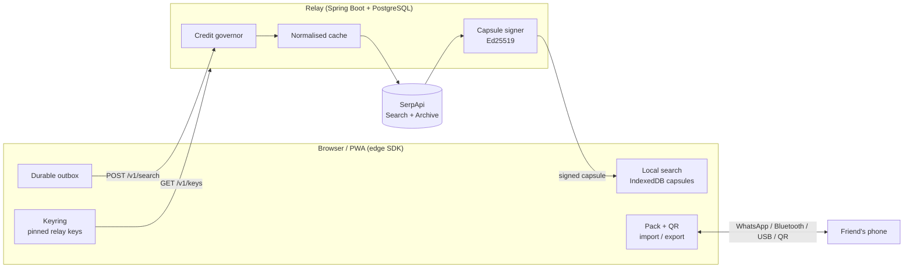

# SetuSync

**Make SerpApi-powered apps keep working when the network doesn't.**

SetuSync is a connectivity-resilience layer for applications built on
[SerpApi](https://serpapi.com). An edge SDK keeps results on the device, a
Relay talks to SerpApi on the user's behalf, and every result is
**cryptographically signed**, so people can pass search results to each other
over WhatsApp, Bluetooth, USB or animated QR codes with no internet, and nobody
can tamper with them on the way.

> "One person with a connection updates a whole village, and nobody can tamper
> with the data."

*Built for the **SerpApi India Hackathon 2026**, track: **Knowledge & Public Interest**.*

| | |
|---|---|
| **Demo video** | `<!-- TODO: paste your public video link (under 3 minutes) -->` |
| **Live demo** | `<!-- TODO: paste your deployed URL, or delete this row -->` |
| **Team** | `<!-- TODO: names / GitHub handles -->` |

---

## 1. The problem

Anything built on live search (health information, government schemes, jobs,
local services) fails exactly where it is needed most: villages, field
surveys, trains, tunnels, and congested city networks. A normal SerpApi app
shows a spinner, then an error. It also **spends a paid search credit every
time** someone asks a question that a neighbour asked ten minutes ago.

## 2. What SetuSync does

| Feature | What the user gets |
|---|---|
| **Offline search + durable outbox** | Search saved results with no signal. Searches made offline are kept and sent automatically when the connection returns |
| **Capsule Packs (`.setupack`)** | Bundle verified results into one compressed file. Send it by WhatsApp, Bluetooth, AirDrop or USB; the receiver verifies the signature before storing anything |
| **Animated QR transfer** | Move a few results phone-to-phone with only a camera. No pairing, no network |
| **Provenance receipts** | Every result shows where it came from and which key signed it |
| **Query normalisation** | "tokyo best cafes?" and "Best cafe in Tokyo" are recognised as one search, so one SerpApi credit serves many people |
| **Volatility-aware freshness** | Learns how fast each search changes, so it can say "rarely changes" instead of using a fixed expiry |
| **Hinglish-friendly offline search** | Typo-tolerant search over saved results, including common romanised Hindi terms ("sarkari yojana", "aspataal") |
| **Impact dashboard** | Credits avoided, questions answered offline, data that never touched the relay, all measured on the device |
| **Network lab** | Simulate 3G / 2G / 30% loss / a tunnel and compare a typical app against SetuSync side by side |
| **Nearby phone-to-phone (WebRTC)** | Two phones on the same Wi-Fi or hotspot connect by scanning two QR codes (no signalling server) and swap only the searches the other is missing. Everything is signature-checked |
| **Delta capsules** | When a search changed, send only what changed. The receiver rebuilds the exact signed capsule from the version it already holds, and the signature check proves it is correct. The app measures the bytes saved |
| **Background Sync** | Searches queued offline are completed by the service worker when the connection returns, even if the tab was closed. Results are verified when the app next opens |
| **Smart search (on-device AI)** | A small sentence model (transformers.js, about 25 MB) runs in the browser, so "cheap places to eat" finds "budget restaurants" with no network. Hinglish is understood too |
| **Opportunistic sync** | When the Network Information API reports a better connection, queued searches go out first |
| **Installable PWA** | The app itself opens with no connection once it has been visited |
| **Credit governor** | Monthly and per-device limits so a demo can never overspend the SerpApi plan |
| **Community hub** | Run the Relay on a spare laptop's hotspot and serve everyone nearby ([guide](docs/COMMUNITY-HUB.md)) |

### What makes it different

- **WhatsApp becomes the sync network.** One person with a connection fetches results; everyone else receives them as a file or a stream of QR codes. No server, no pairing, no data plan needed on the receiving phone.
- **Tamper-proof by design.** Results are signed by the Relay, so they can travel over any untrusted channel. Change one byte of a `.setupack` and the import is rejected.
- **A visible chain of trust.** Each result shows its custody trail (signed by the Relay, shared by a friend's phone, imported on this device) and the signing key's fingerprint.
- **No server, no internet, no pairing codes.** Two phones connect over WebRTC by scanning two QR codes, then exchange only what the other is missing, and only the changes when it already has an earlier version.
- **Finishes the job after you leave.** Searches queued offline are completed by Background Sync even with the tab closed.
- **Understands meaning offline.** On-device semantic search finds related results without any network once the model is cached.
- **Fewer SerpApi credits.** Near-duplicate questions collapse into one search, and results shared peer-to-peer never touch the Relay. The Impact dashboard shows the real numbers measured on the device.
- **Proof, not claims.** The Network lab runs a typical app and SetuSync side by side on simulated 2G, 3G and 30% packet loss, so the difference is visible on stage.
- **Honest wording.** This is *opportunistic peer sharing between people*, not a mesh network.

## 3. How SerpApi is used (and why it matters)

SerpApi is not an add-on here. Every result the app shows is a SerpApi result,
and SetuSync's whole purpose is to make SerpApi usable in places it otherwise
would not be.

- **Live search:** the Relay uses the official SerpApi Java library to submit
  searches with `async=true` (the engine and parameters come from the request;
  the demo app uses the Google Search API).
- **Search Archive API:** the Relay polls and retrieves finished searches from
  the SerpApi Search Archive, so a slow or dropped connection never loses a result.
- **Credit efficiency:** results are cached under a normalised key, so
  repeated and near-duplicate questions cost zero credits. A governor enforces
  a monthly budget and a per-device quota.
- **Signed capsules:** each SerpApi response is compiled into a *capsule*
  (results, freshness and request identity) and signed with Ed25519. This is
  what lets results travel safely over untrusted channels.

## 4. Architecture



### Trust model

- The Relay signs every capsule (Ed25519 over the canonical JSON body).
- A device learns the Relay's public key from `GET /v1/keys` (trust on first use over HTTPS).
- A pack from someone else is checked against those keys. A **new** key is never accepted silently: the user sees its fingerprint and must approve it, like an SSH host key.
- A key ID can never be re-bound to a different key.
- Only results whose signature verified are ever exported.
- The custody chain inside a pack (origin → exporter → importer) is informational and unsigned. The capsule signature is what is cryptographic.

### Tech stack

| Layer | Technology |
|---|---|
| **Search provider** | [SerpApi](https://serpapi.com): Search API (`async=true`) and Search Archive API, via the official `serpapi-java` library |
| **Relay (backend)** | Java 21, Spring Boot 4.1 (web, JDBC, Actuator), Maven, Jackson and Gson, `java-json-canonicalization` (RFC 8785 canonical JSON), Ed25519 signing |
| **Database** | PostgreSQL 17 (cache, search jobs, signing keys, credit ledger) |
| **Web app** | TypeScript, React 19, Vite 8, installable PWA (service worker) |
| **Edge SDK** | TypeScript, IndexedDB for on-device storage, MiniSearch for offline full-text search, WebCrypto Ed25519 for signature verification, gzip via `CompressionStream`, delta capsules, WebRTC data channels for peer transfer |
| **On-device AI** | transformers.js (`@huggingface/transformers`) with the all-MiniLM-L6-v2 quantised model on ONNX Runtime Web (WebAssembly), loaded on demand |
| **Shared protocol** | TypeScript package: capsule schema (Ajv), canonical JSON (`canonicalize`), SHA-256 (`@noble/hashes`), golden test vectors shared with the Relay |
| **Sharing** | `.setupack` files via the Web Share API, animated QR codes (`qrcode` to display, `jsqr` to scan), WebRTC with QR signalling, Background Sync API and a service worker, Network Information API for opportunistic sync |
| **Testing** | Vitest (protocol, SDK, demo) and JUnit via Spring Boot Test (Relay) |
| **Deployment** | Docker and Docker Compose, nginx serving the app and proxying `/v1/*` to the Relay |

## 5. Repository layout

```
apps/relay          Spring Boot Relay: governor, cache, SerpApi client, signer, /v1 API
apps/demo           React + Vite PWA (search, share & receive, impact, network lab)
apps/benchmark      Benchmark harness
packages/protocol   Shared capsule format, canonical JSON, hashing, test vectors
packages/edge-sdk   Offline store, search, outbox, sync engine, keyring, packs, QR transfer
tools/netsim-bench  Network simulation used by the Network lab
infra/              Deployment helpers
docs/               Community hub guide
scripts/            generate-signing-key.mjs, diagnose-signature.mjs
```

## 6. Quick start (Docker)

Prerequisites: Docker, Node 20+ and a free
[SerpApi key](https://serpapi.com/manage-api-key) (250 searches a month).

```bash
git clone <your-repo-url> && cd SetuSync
cp .env.example .env
node scripts/generate-signing-key.mjs      # paste the 3 printed lines into .env
# also set SERPAPI_KEY=... in .env
docker compose up -d --build
```

Open <http://localhost:8089> (the port is `WEB_PORT` in `.env`).

The web container serves the app and proxies `/v1/*` to the Relay, so there is
one public URL and no CORS setup. Check the Relay started correctly:

```bash
docker compose logs relay | grep "signing key"   # expect: Registered signing key ... as ACTIVE
```

### Local development

```bash
docker compose up -d postgres
cd apps/relay && ./mvnw spring-boot:run          # needs SERPAPI_KEY and SETUSYNC_SIGNING_* in the environment
# second terminal, from the repo root
npm install && npm run dev -w @setusync/demo     # http://localhost:5173
```

Requires Java 21 for the Relay.

## 7. Configuration

| Variable | Default | Meaning |
|---|---|---|
| `SERPAPI_KEY` | required | Your SerpApi API key |
| `SETUSYNC_SIGNING_PRIVATE_KEY_PKCS8_B64` | required | Ed25519 private key (**secret**) |
| `SETUSYNC_SIGNING_PUBLIC_KEY_SPKI_B64`, `SETUSYNC_SIGNING_KID` | required | Registered as the ACTIVE key at startup. Change the KID whenever you generate a new key pair |
| `SETUSYNC_GOVERNOR_MONTHLY_CREDIT_BUDGET` | 240 | Live searches per month. `0` refuses every search |
| `SETUSYNC_GOVERNOR_PER_INSTALL_CREDIT_QUOTA` | 40 | Live searches per device |
| `SETUSYNC_GOVERNOR_GLOBAL_KILL_SWITCH` | false | Stop live searches; cached results are still served |
| `SETUSYNC_CORS_ALLOWED_ORIGINS` | localhost | Only needed if the Relay is on another domain |
| `RELAY_URL` (web container) | empty = same origin | Full Relay URL if you do not use the built-in proxy |
| `DB_URL`, `DB_USERNAME`, `DB_PASSWORD` | local Postgres | Database |

**Never commit `.env`.** It is already in `.gitignore`.

## 8. Demo walkthrough (about 4 minutes)

1. **Online.** Search "best cafe in Tokyo" and press *Search live*. Results arrive with a **Verified** badge.
2. **Rephrase.** Search "tokyo best cafes?". SetuSync recognises the same search and spends no credit.
3. **No signal.** Tick *Simulate no connectivity* and search the saved results. Search something new and choose *Save for later*; it queues. Untick, and it sends itself.
4. **Share.** *Share & receive* → share as a file (WhatsApp, Bluetooth, USB) or *Show as QR*. On a second browser or phone, *Import file* or *Scan QR*, check the fingerprint, and the results appear as verified.
5. **Attack.** Edit one byte of the `.setupack` and import it. It is rejected.
6. **Lab.** *Network lab* → pick a lossy network → *Compare*. A typical app fails; SetuSync still delivers.
7. **Impact.** Show credits avoided and data that never touched the Relay.

### Trying the newer features

- **Nearby transfer:** on two devices on the same Wi-Fi, open *Share & receive*. On one, tap *Start a transfer* and show the code; on the other tap *Join a transfer* and scan it, then show the reply code back to the first. Searches flow both ways.
- **Delta update:** fetch a search, share it to a second device, let the search change and refresh it, then tap *Share only changes*. The file is much smaller and the other device ends up with the exact signed result.
- **Background Sync (Chromium browsers):** go offline, search something new and choose *Save for later*, close the tab, reconnect. The result is waiting when you reopen the app.
- **Smart search:** tap *Turn on smart search* once while online, then search by meaning (for example "cheap places to eat") even offline.

## 9. Tests

```bash
npm install && npm test          # protocol, edge-sdk and demo (vitest)
cd apps/relay && ./mvnw test     # Relay
```

If a result ever shows "Signature failed", this helper reports which check fails (content hash, capsule ID or signature):

```bash
node scripts/diagnose-signature.mjs http://localhost:8089 "your query"
```

## 10. Deployment notes

- Browsers need **HTTPS or `localhost`** for the camera (QR scan), the share sheet and PWA install. Put any HTTPS reverse proxy in front for a public demo.
- Free hosting tiers that sleep when idle will make the first request slow; warm the Relay before presenting.
- The Relay needs PostgreSQL and outbound access to `serpapi.com`.

## 11. Troubleshooting

| Symptom | Cause / fix |
|---|---|
| "…budget is used up / not configured" | Governor limits. Raise `SETUSYNC_GOVERNOR_*` (never `0`) |
| "relay has no SerpApi key configured" | `SERPAPI_KEY` is missing in the Relay container |
| Search accepted but never completes | No ACTIVE signing key. Check the Relay log and set the 3 signing variables |
| "Not checked yet" on results | The device has no Relay key yet. Open the app once while online |
| "Signature failed" | The capsule did not verify. It is kept but never shared. Run the diagnose script above |
| Scan QR / Share / install unavailable | Needs HTTPS or `localhost` |
| Smart search says it could not start | The model downloads once from Hugging Face. Connect, then try again. It works offline afterwards |
| Nearby transfer will not connect | Both phones must be on the same Wi-Fi or hotspot. Some networks block device-to-device traffic (guest Wi-Fi, client isolation); use a phone hotspot instead |
| `Could not reach the relay…` | Relay down, wrong `RELAY_URL`, or CORS. The request stays queued and retries |
| `UnsupportedClassVersionError` | Needs Java 21 |

## 12. Known limits

- QR transfer is meant for a few searches (about 13 KB). For larger sets, share the file.
- Ed25519 in WebCrypto needs a recent browser (Chrome 137+, Firefox 129+, Safari 17+). Older browsers show results as "not checked" and cannot export.
- Peer sharing is **opportunistic sharing between people**, not a mesh network.
- iOS has limited Web Bluetooth and share support. The file route (WhatsApp, AirDrop) works everywhere.
- **WebRTC** uses no STUN/TURN servers, so it works on the same local network only. Networks with client isolation block it.
- **Background Sync** is supported by Chromium browsers (Chrome, Edge) only. Elsewhere, queued searches are sent when the app is open. The service worker never verifies anything: results are checked when the app opens.
- **Delta updates** work only when the receiver already holds the exact earlier version. Otherwise the app asks for a full pack. Deltas between the Relay and the device are not implemented; deltas are used for sharing between devices.
- **Smart search** downloads about 25 MB from Hugging Face the first time, then runs offline. Its WebAssembly runtime is served by the app itself. Quality is that of a small model.
- Predictive prefetch of likely searches is not implemented.

## 13. Hackathon notes

**Judging criteria**

| Criterion | Where to look |
|---|---|
| Idea strength | Sections 1 and 2: resilient, shareable, tamper-proof search for low-connectivity users |
| Originality | Signed capsules that travel over WhatsApp / QR with no server; key pinning with fingerprints |
| Technical complexity | Ed25519 canonical-JSON signing across a Java Relay and a TypeScript SDK, durable outbox, packs, QR streaming, credit governor |
| Usefulness | Fewer SerpApi credits spent, results available offline, one connected person can serve many |
| Meaningful SerpApi usage | Section 3: every result comes from SerpApi (live search + Search Archive) |

**Disclosures**

- **Existed before the hackathon:** `<!-- TODO: yes/no, and what was built during the hackathon -->`
- **AI tools used:** Claude (Anthropic) assisted with design, coding, debugging and documentation. All code was reviewed and tested by the team, who remain responsible for it.
- **Secrets:** no API keys or private keys are committed. `.env` is git-ignored.

## 14. License

MIT, see [LICENSE](LICENSE).
